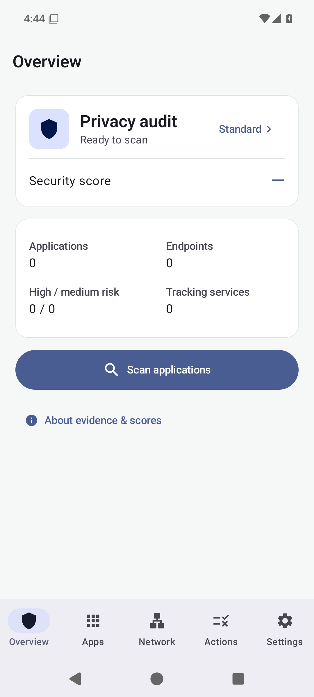
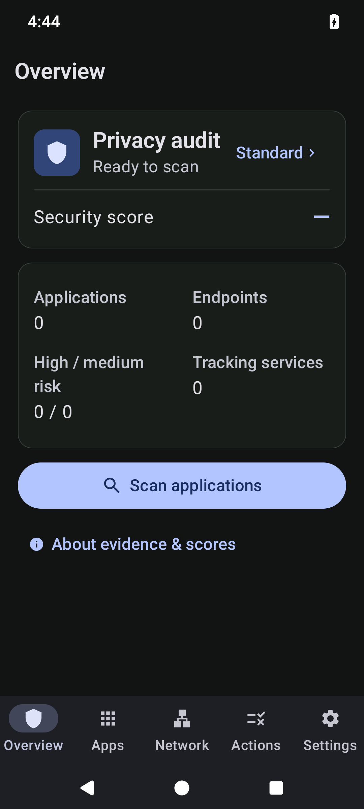
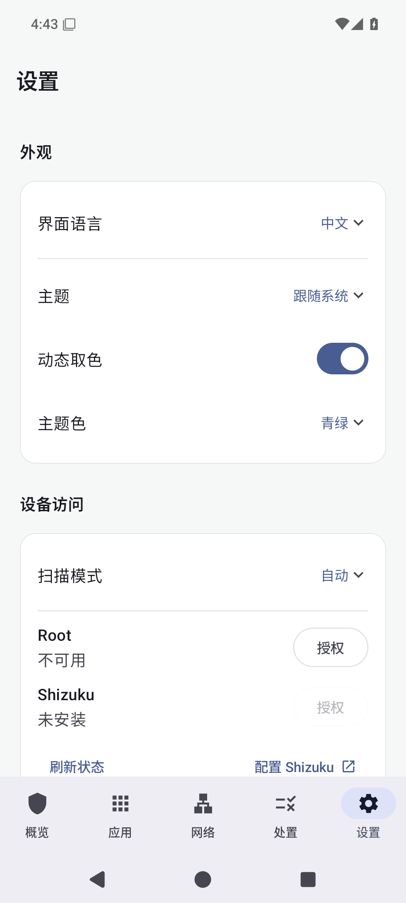

# sososafe

看清权限，读懂连接。

Android 本地隐私审计与网络监控。

[下载 APK](https://github.com/vexpaer/sososafe/releases/latest) · [使用说明](docs/TECHNICAL.md) · [更新日志](CHANGELOG.md)

  
  
  

## 下载

从 [Releases](https://github.com/vexpaer/sososafe/releases/latest) 下载 **sososafe.apk**，直接安装。支持 ARM64、ARMv7 和 x86_64，无需电脑或开发环境。

首次启动选择中文或 English，之后可在 **设置 → 外观 → 界面语言** 切换。

## 能做什么

- **审计应用** — 权限、授权状态、AppOps、共享 UID 与风险证据。
- **分析 APK** — Manifest、DEX、SDK、域名和 API 端点，支持文件导入。
- **观察网络** — 本地 VPN 转发 TCP/UDP，记录连接、DNS 与应用流量。
- **处理风险** — 确认后限制权限、停用或卸载，保留操作历史与回滚入口。
- **导出报告** — JSON、Markdown、TXT，通过系统分享或另存。

普通模式安装即可使用。Shizuku 与 Root 在授权后提供更多系统信息，三种模式共用分析引擎。Material You、动态取色、深浅主题与平板布局均可使用。

## 隐私

无账户、无广告、无遥测。审计在本机完成，不上传 APK 或扫描结果。VPN 不使用外部代理服务器，不解密 HTTPS。

每项发现附带来源。静态引用与实际连接分别呈现，评分用于辅助检查。详细访问边界见 [技术说明](docs/TECHNICAL.md)。

## 开发

Kotlin · Jetpack Compose · Material 3 · Room · DataStore。

所有 Android 构建、测试和打包均在 GitHub Actions 执行。[验证记录](docs/VALIDATION.md) · [贡献指南](CONTRIBUTING.md) · [安全报告](SECURITY.md)

## 许可

[MIT](LICENSE)。基于 [NOIR](https://github.com/Verlintas/NOIR) 的分析逻辑与 [HevSocks5Tunnel](https://github.com/heiher/hev-socks5-tunnel) 的本地转发引擎。完整声明见 [第三方许可](THIRD_PARTY_NOTICES.md)。
